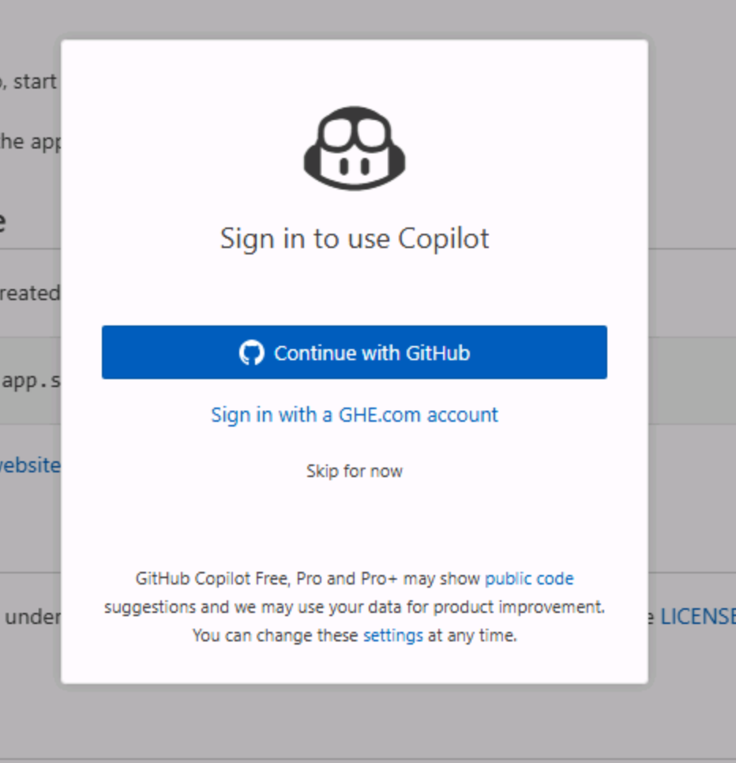

VS Code の演習を始める前に、必要な環境を準備します。Tailspin Toys リポジトリの自分用コピーを作成し、作業用の [Codespace][codespaces] を起動して、エディターで GitHub Copilot Chat が利用できることを確認します。

## ラボ用リポジトリを準備する

コード用のリポジトリを作成するには、[テンプレート][template-repository]から自分用のインスタンスを作ります。新しいインスタンスにはラボに必要なファイルがすべて含まれており、演習を通して使用します。

1. 新しいブラウザーウィンドウで [Tailspin Toys のテンプレート][tailspin-template]を開きます。
2. ラボのリポジトリページで **Use this template** を選択し、次に **Create a new repository** を選択して、自分用のコピーを作成します。

    

3. GitHub または Microsoft が主催するイベントでワークショップを受講する場合は、メンターの指示に従ってください。それ以外の場合は、GitHub Copilot を利用できる組織に新しいリポジトリを作成できます。

    

4. 作成したリポジトリのパス (**organization-or-user-name/repository-name**) をメモします。ラボの後半でこのパスを使います。

> [!NOTE]
> **バックログの準備は完了しています**
>
> テンプレートからリポジトリを作成すると、GitHub Issue のバックログも自動で作成されます。ワークショップではこの Issue を使います。自分で Issue を作成する必要はありません。

## Codespace を作成する

次に、ラボの演習で使用する Codespace を作成します。

[GitHub Codespaces][codespaces] はクラウドベースの開発環境です。ブラウザーから直接コードを記述、実行、デバッグできます。複数のプログラミング言語、拡張機能、ツールに対応した、必要な機能を備える IDE です。

1. 作成したリポジトリを開きます。
2. 緑色の **Code** ボタンを選択します。

    

3. **Codespaces** タブを選択し、**+** ボタンを選択して新しい Codespace を作成します。

    

Codespace の作成には数分かかりますが、すべてのサービスを手動でインストールするよりはずっと早く完了します。その間に、次に紹介する GitHub Copilot の機能を確認できます。

> [!CAUTION]
> 今後の演習で Codespace に戻ります。ここでは、ブラウザーのタブで開いたままにしてください。

> [!NOTE]
> このワークショップは Codespace またはローカルの [dev container][dev-containers] で実行するように構成されています。どちらも、演習をスムーズに進めるために必要な前提条件がすべてインストールされた環境です。ローカルで実行する場合は、クローンしたリポジトリを VS Code で開き、メッセージが表示されたら **Reopen in Container** を選択してください。Codespace と同じ dev container が構築されます。

[codespaces]: https://github.com/features/codespaces
[dev-containers]: https://code.visualstudio.com/docs/devcontainers/containers

## GitHub Copilot Chat とエージェントモードを使う

GitHub Copilot Chat のエージェントモードを使うには、IDE に GitHub Copilot Chat 拡張機能がインストールされている必要があります。GitHub Codespace を利用している場合は、通常すでにインストールされています。

> [!TIP]
> GitHub Copilot Chat 拡張機能がインストールされていない場合は、[Visual Studio Code Marketplace からインストール][copilot-chat-extension]できます。または Visual Studio Code で Extensions ビューを開き、**GitHub Copilot Chat** を検索して **Install** を選択します。

拡張機能をインストールしたら、GitHub アカウントで認証して有効にする必要がある場合があります。

1. Codespace に戻ります。
2. エディターの右側に Copilot Chat が表示されていない場合は、Codespace の上部にある **Copilot Chat** アイコンを選択します。
3. Copilot Chat ウィンドウで「Hello world」のようなメッセージを入力し、Enter キーを押します。Copilot Chat が有効になります。
4. 未認証の場合は、GitHub アカウントへのサインインを求められます。画面の指示に従って認証します。

    

5. 認証後、Copilot Chat ウィンドウが表示されます。

## まとめ

ラボ用リポジトリのコピーを作成できました。また、コードを書き始める際に使用する Codespace の作成を開始しました。

## 次のステップ

Copilot に作業を依頼しましょう。[演習 1 - カスタム指示][next-lesson]に進み、Copilot にプロジェクトの規約を伝えます。

## リソース

- [GitHub Codespaces の概要][codespaces]
- [テンプレートからリポジトリを作成する][template-repository]
- [Codespaces の利用を開始する][codespaces-quickstart]

[tailspin-template]: https://github.com/github-samples/tailspin-toys
[template-repository]: https://docs.github.com/repositories/creating-and-managing-repositories/creating-a-template-repository
[codespaces-quickstart]: https://docs.github.com/codespaces/getting-started/quickstart
[copilot-chat-extension]: https://marketplace.visualstudio.com/items?itemName=GitHub.copilot-chat
[next-lesson]: ../1-custom-instructions/
